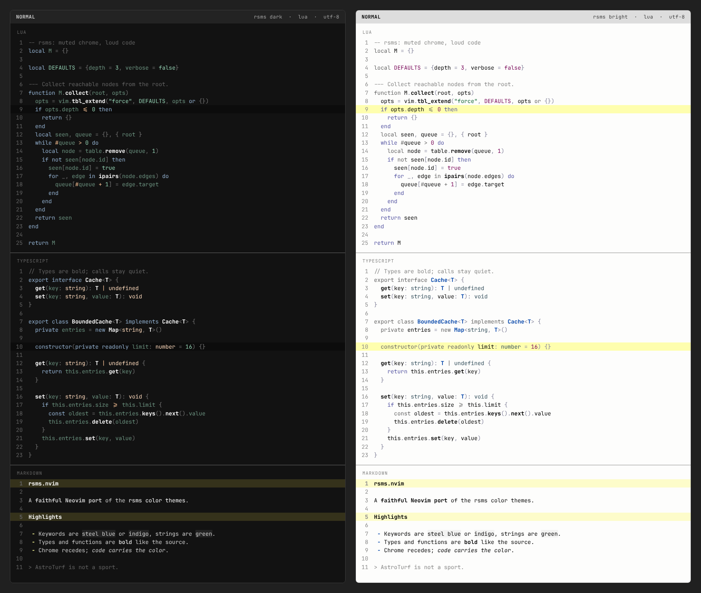

# rsms.nvim

A Neovim port of the [rsms color themes](https://github.com/rsms/vscode-theme),
with both **rsms dark** and **rsms bright** variants.



## Style

The source themes are restrained but not colorless: chrome recedes, while a
small set of hues carries syntax. This port keeps that division:

- **Source-faithful hues** — dark keywords are steel blue, bright control
  keywords indigo; strings are green in both; constants are green (dark) or
  purple (bright); types are bold white (dark) or bold blue (bright); tags are
  peach (dark) or violet (bright). Every hue is an anchor from the source.
- **Chrome recedes** — comments, punctuation, line numbers, separators, and
  statuslines are alpha-derived grays. The source's `#ffffff66`-style colors
  are composited over the variant background, because Neovim has no alpha.
- **Decoration is an allowlist** — the source uses bold type and function
  names, bold/italic markdown, and underlined links. Those stay; every other
  inherited bold/italic/underline is stripped. `scripts/check.lua` enforces
  the allowlist.
- **Both backgrounds** — the bright variant is a first-class port, not an
  inverted dark theme: it has its own yellows, indigos, and bracketed
  headings, just like the source.

### Alpha flattening and derived shades

Source anchors that carry alpha (`#rrggbbaa`) are flattened over the variant
background before they reach `nvim_set_hl`. Where a source alpha misses WCAG's
floors as real text (line numbers, separators), the derived shade is raised.
A handful of bright-variant hues are darkened for body text on `#fdfdfc`
(regexp pink, warning ochre, hint teal). See `GLOSSARY.md` for the vocabulary.

## Requirements

- Neovim 0.9+
- `termguicolors` (enabled automatically when the colorscheme loads)

## Installation

With [lazy.nvim](https://github.com/folke/lazy.nvim):

```lua
{
  "you/rsms.nvim", -- or: dir = vim.fn.expand("~/Documents/repos/rsms")
  lazy = false,
  priority = 1000,
  config = function()
    require("rsms").setup({
      terminal_colors = true, -- set vim.g.terminal_color_0..15
    })
    vim.cmd.colorscheme("rsms")
  end,
}
```

## Usage

```vim
:colorscheme rsms          " follows 'background'
:colorscheme rsms-dark     " force the dark variant
:colorscheme rsms-bright   " force the bright variant
```

`:colorscheme rsms` reads `vim.o.background`; set it to `light` or `dark`
before loading to pick a variant. The explicit colorscheme names always set
`background` themselves.

There is exactly one option. Call `setup()` **before** loading the
colorscheme:

```lua
require("rsms").setup({ terminal_colors = false })
```

A transparent background is intentionally unsupported: each variant keeps its
source background (`#121212` / `#fdfdfc`). Passing an unknown option raises an
error.

## Palette

Anchors are the exact source values (some carry alpha); rendered values are
what the highlight groups actually receive. The full terminal palettes live in
[`assets/rsms-dark`](assets/rsms-dark) and
[`assets/rsms-bright`](assets/rsms-bright).

| Role | rsms dark | rsms bright |
| --- | --- | --- |
| background | `#121212` | `#fdfdfc` |
| foreground | `#d0d0d0` (source `#ffffffcc`) | `#000000` |
| comment | `#656565` (source `#ffffff59`) | `#868685` (source `#00000078`) |
| punctuation | `#717171` (source `#ffffff66`) | `#86869d` (source `#00003378`) |
| keyword | `#94b2d1` | `#656565` |
| control keyword | `#94b2d1` | `#5353a1` (source `#000075ab`) |
| function | `#ffffff` bold | `#000000` bold |
| type | `#ffffff` bold | `#0043a8` bold |
| builtin type | `#ffdbbd` | `#334e5b` (source `#002233cc`) |
| string | `#94d1b3` | `#116432` |
| constant | `#94d1b3` | `#750054` |
| variable | `#6c9380` | `#000000` |
| operator | `#ffc799` | `#656565` |
| tag | `#ffdbbd` | `#66559b` |
| error | `#f7796e` | `#990000` |
| warn | `#ffff99` | `#886d36` |
| info | `#75b2f0` | `#0043a8` |
| hint | `#71c1c1` | `#447474` |
| ok | `#3df599` | `#2f7b0a` |
| cursor | `#f76ec9` | `#0044ff` |
| selection | `#2b4659` (source `#66c2ff4c`) | `#d2ecfe` (source `#a8dcff80`) |
| cursorline | `#0c0c0c` | `#fefeae` (source `#ffff004f`) |
| separator | `#696969` | `#8b8b8b` |

Terminal palettes are built from the theme anchors:

| | 0 | 1 | 2 | 3 | 4 | 5 | 6 | 7 |
| --- | --- | --- | --- | --- | --- | --- | --- | --- |
| dark | `#252525` | `#f7796e` | `#94d1b3` | `#ffc799` | `#75b2f0` | `#f76ec9` | `#71c1c1` | `#d0d0d0` |
| bright | `#333333` | `#990000` | `#116432` | `#886d36` | `#0043a8` | `#750054` | `#447474` | `#656565` |

| | 8 | 9 | 10 | 11 | 12 | 13 | 14 | 15 |
| --- | --- | --- | --- | --- | --- | --- | --- | --- |
| dark | `#5a5a5a` | `#f8897f` | `#a7d9c1` | `#ffff99` | `#94b2d1` | `#f888d3` | `#8dcdcd` | `#ffffff` |
| bright | `#868685` | `#cc2900` | `#2f7b0a` | `#aa8844` | `#265fb5` | `#aa2298` | `#3a6363` | `#000000` |

## Coverage

Core UI and syntax, Treesitter captures, LSP semantic tokens, diagnostics,
diff, git, marks, spelling, rainbow brackets (VS Code bracket-pair colors),
indent-blankline, markdown, and the embedded terminal. Groups outside that
surface fall back to Neovim's default links.

## Accessibility

Every rendered fg/bg pair is audited against WCAG 2.1 AA for both variants:
body text ≥ 4.5:1, secondary text (comments, line numbers, punctuation) ≥ 3:1,
non-text UI ≥ 3:1. Purely decorative markers, bracket colors, and diagnostic
virtual text are deliberately exempt. Backgrounds are fixed source values; all
remedies are foreground-side.

```sh
nvim --clean --headless -l scripts/check.lua   # assertions + per-tier worst case
nvim --clean --headless -l scripts/wcag.lua    # full contrast report, both variants
scripts/preview.sh                             # HTML preview + assets/preview.png
```

## Attribution

The color palette and theme concept come from
[rsms/vscode-theme](https://github.com/rsms/vscode-theme) by Rasmus Andersson,
which is distributed under the ISC license. This Neovim port is a derived work
and keeps the same license.

## License

[ISC](LICENSE)
